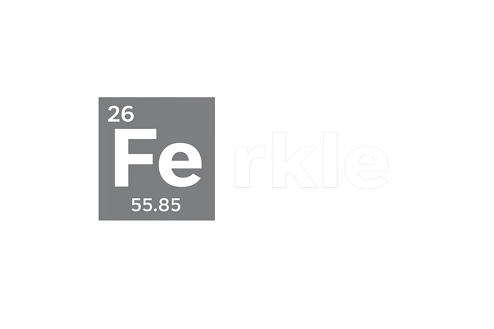

# Ferkle



A terminal Farkle game inspired by Kingdom Come: Deliverance 2. Play 1v1 against a CPU opponent — first to 2000 points wins.

## How to play

```
cargo run
```

On your turn the dice are displayed with position labels:

```
[ 1  3  5  1  2  6 ]
  1  2  3  4  5  6
```

Type the positions of the dice you want to keep (e.g. `1 3 5`), then choose to **bank** your points (`b`) or **roll again** (`r`) with the remaining dice.

## Scoring

| Combination | Points |
|-------------|--------|
| Single 1 | 100 |
| Single 5 | 50 |
| Three 1s | 1000 |
| Three of a kind (n) | n × 100 |
| Four/five/six of a kind | doubles each extra die |
| Straight 1–5 | 500 |
| Straight 2–6 | 750 |
| Straight 1–6 | 1500 |

**Farkle** — if your roll contains no scoring dice, you lose all points accumulated that turn.

**Hot dice** — if all your dice score, pick them all up and roll all 6 again.

## Rules

- Every die you select must participate in a scoring combination — you cannot hold a non-scoring die.
- Bank at any point after a valid selection to lock in your turn score.
- The CPU banks when its turn score reaches 350 or only 2 dice remain.
